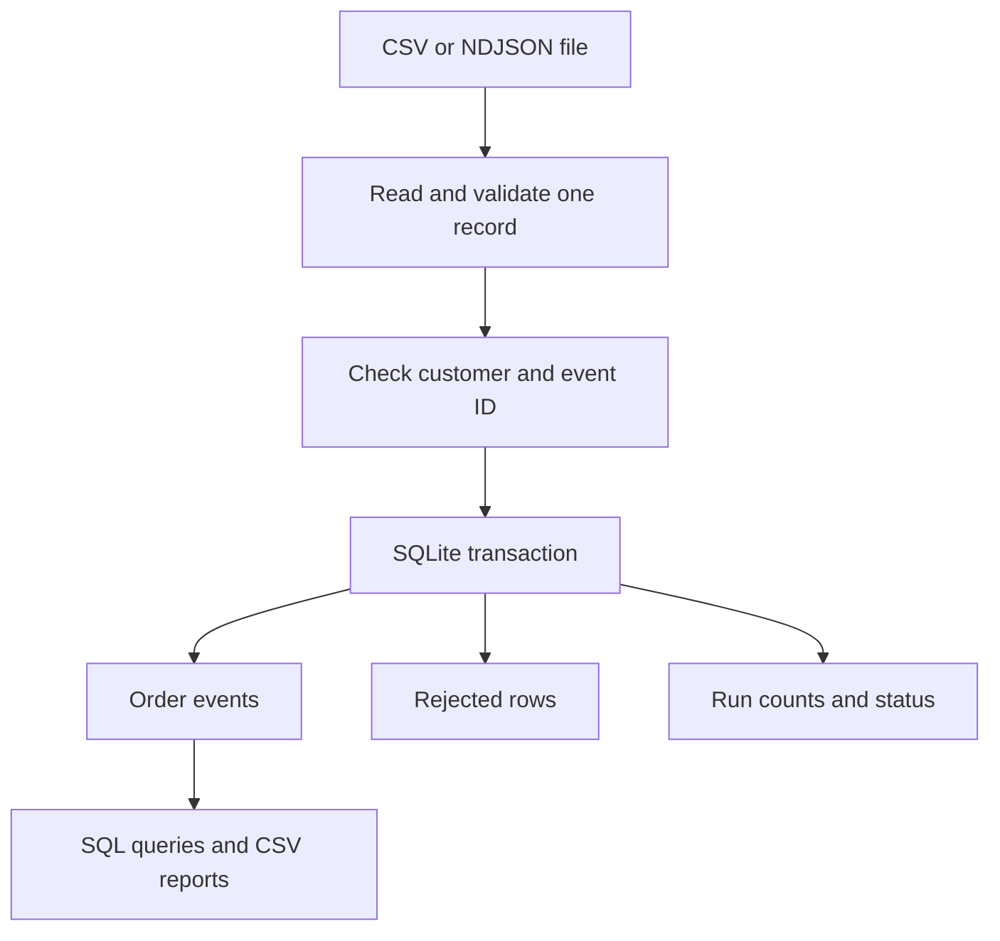

# Design notes

## Processing flow



The producer supplies immutable files and stable event IDs. A data engineer sets
up paths and customer references. Analysts use the event table and summary view;
an operator uses run status, logs and rejected records to investigate problems.

## Why Python and SQLite?

The main problem is file size, so the reader processes one line at a time.
SQLite handles persistent duplicate checks, foreign keys and transactions without
requiring a server. Python's standard library supplies the rest. A distributed
engine could handle more concurrency, but is extra setup for this local workload.

The database cache is set to 4 MiB, and temporary database work uses disk. A line
cannot exceed 1 MiB. Hashing reads fixed 1 MiB chunks. No Python collection grows
with the number of input rows. Parsing still needs space for the decoded record,
which can be larger than its raw bytes. The line limit is not a process memory
limit; the Linux benchmark separately enforces a 128 MiB address-space cap.

Duplicate checks use a primary-key index, so processing is roughly O(N log M),
where M is the number of stored events. Memory depends on the record limit and
cache size rather than N. Database files, indexes and journals do grow on disk.

## Why one transaction per file?

It makes a failed file easy to retry: either its changes are published or they
are rolled back. A chunk-by-chunk commit would need checkpoints and rules for
partly loaded files. The cost is a longer write lock and a potentially large
transaction journal. This version supports one writer, with a 30-second lock timeout.

A run audit row is committed before processing begins. Event and quarantine
writes happen inside the file transaction. On an ordinary exception those writes
roll back, then the failure reason and attempted counts are saved separately.
`committed_count` is zero even if some valid rows were attempted before failure.
If the database cannot be opened or written, the CLI reports the error, but it
cannot promise a saved audit record in that same unavailable database.

The source is hashed before and after processing. A changed hash fails the run.
This adds two reads of the file but keeps memory bounded. It detects ordinary
changes, not every possible concurrent modification; immutable sources are still
required. Staging a private copy would be a better option for mutable producers.

## Retry, restart and backfill

Retry uses the same command and starts at the first record. Matching event IDs
are skipped; conflicting content is rejected. Audit records are per attempt,
so a retry can add audit and reject records without duplicating business events.
Late events and older backfill files are accepted without replacing newer events.

A hard kill or power loss cannot run the Python error handler. SQLite recovers
its incomplete transaction when reopened, but the audit may still say `running`.
After confirming that the worker is gone, mark that run failed and replay:

```sql
UPDATE runs SET status='failed', ended_at=strftime('%Y-%m-%dT%H:%M:%SZ','now'),
  failure_reason='operator confirmed interrupted worker', committed_count=0
WHERE run_id='<interrupted run UUID>' AND status='running';
```

Attempt counts that were not committed cannot be recovered after a hard kill.
Tests cover ordinary exceptions and injected partial failures. Power-loss recovery
relies on SQLite and this operator procedure; it is not a separate tested feature.

Reports read a single database snapshot. Each CSV is written to a temporary file
then renamed. The report folder as a whole is not replaced atomically. If an
export fails, rerun it; SQLite remains the source of truth.

## Measurement and next improvement

`evidence/performance.json` records input size, elapsed time, rows per second,
peak RSS, platform and Python version. Counts and net cents are compared with
separate expected-answer files. Generation and reports are outside the ingestion
timer; cache temperature is not controlled. These are local measurements.

One next experiment would be inserting bounded groups of about 1,000 validated
rows with `executemany`, using staging and an indexed merge to keep duplicate
handling correct. This could reduce Python-to-SQL calls. It needs a comparison
benchmark before replacing the simpler per-record approach.

Other limits: one currency, no tax or purchase/refund matching, a mock customer
list, no automatic schema migration or stale-worker detection. Individual amounts
are capped at 10^12 cents. SQLite's SUM uses signed 64-bit integers and fails if
the aggregate overflows; larger totals need partitioning or another numeric engine.
